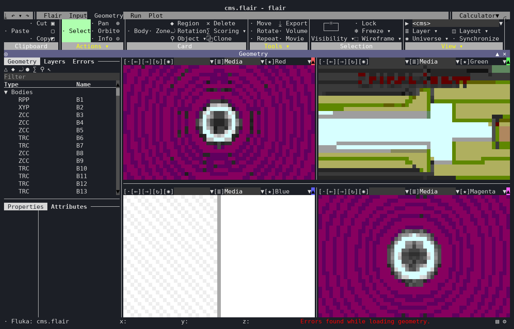
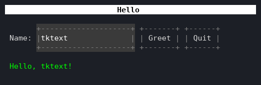
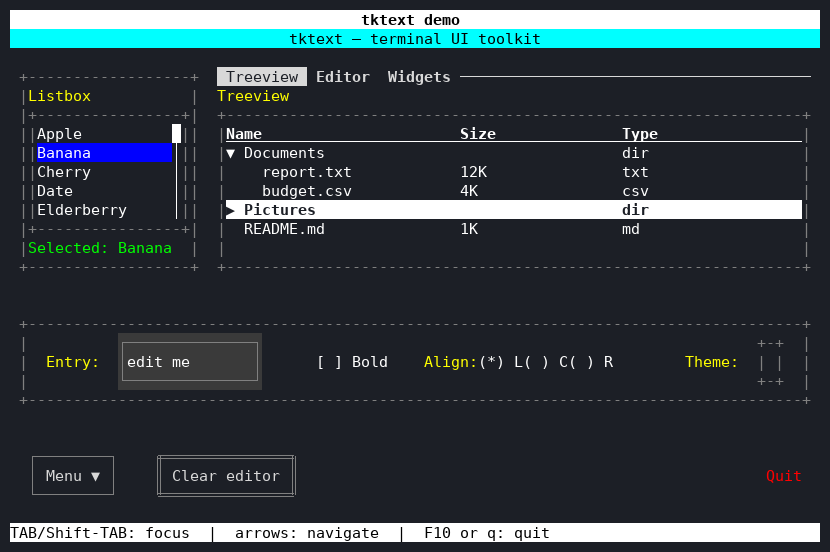
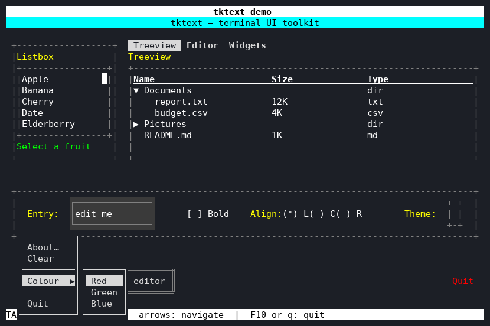
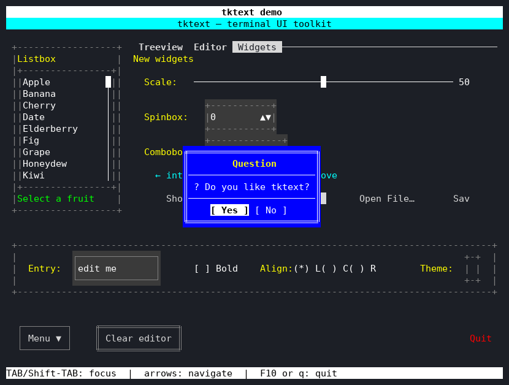
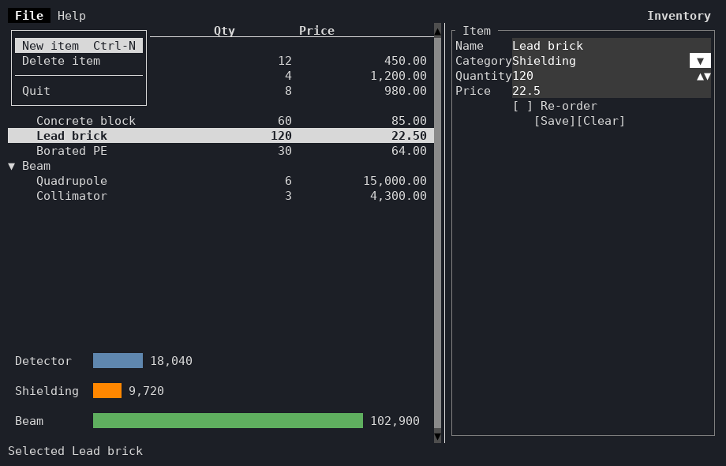
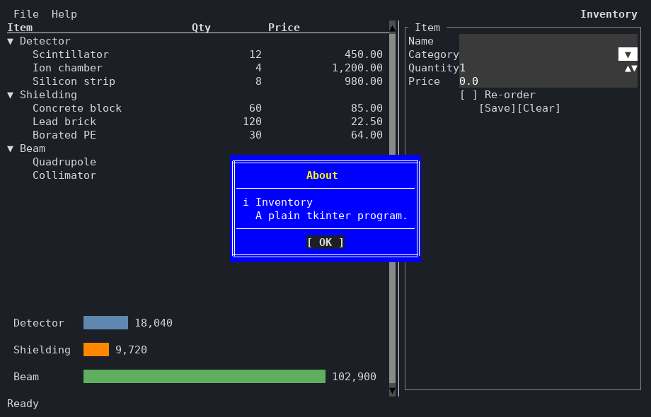
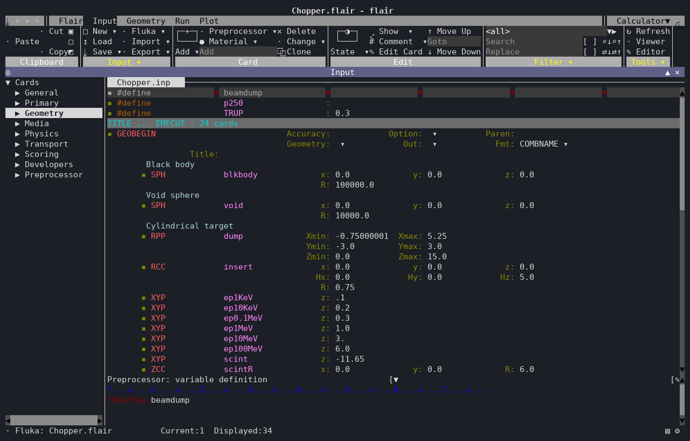

# tktext

**tkinter for the text terminal.**  tktext implements the tkinter API on top of
curses, so a tkinter program runs in a terminal window — over SSH, inside
`screen`, on a machine without X — with its widgets, geometry managers,
variables, bindings, menus and dialogs, driven by keyboard *and* mouse.



*Above: [flair](https://flair.web.cern.ch), a large tkinter application, running
unmodified in a terminal through tktext — including its geometry viewer.*

- Pure Python, standard library only (`curses`); Python 3
- Two modes: **native** (`import tktext as tk`, sizes in character cells) and
  **drop-in** (`tktext.install()`, the program keeps importing `tkinter` and
  measuring in pixels)
- Widgets: `Label`, `Button`, `Entry`, `Text`, `Listbox`, `Treeview`, `Canvas`,
  `Checkbutton`, `Radiobutton`, `Scale`, `Spinbox`, `Combobox`, `Scrollbar`,
  `Notebook`, `PanedWindow`, `Menu`/`Menubutton`/`OptionMenu`, `Frame`,
  `LabelFrame`, `Toplevel`, `Separator`, `Progressbar`, plus the `ttk` versions
- `pack`, `grid` and `place`; `StringVar`/`IntVar`/… with traces; `bind`,
  `bind_class`, `bind_all`, virtual events, `after`, `wait_window`, `grab_set`
- Dialogs: `messagebox`, `filedialog`, `simpledialog`, `colorchooser`
- Mouse (click, double click, drag, wheel), system clipboard, terminal resize,
  dark/light terminal detection, themes, 256/truecolor pixel images

---

## Requirements and installation

- Python 3 with the standard `curses` module (developed with Python 3.14)
- A terminal with `curses` support (Linux, macOS, WSL)
- A Unicode font; 256 colours and mouse reporting recommended
  (`TERM=xterm-256color`)

There is nothing to build: put the directory that contains the `tktext/`
package on `PYTHONPATH` (or next to your program).

```bash
git clone <repository> tktext
cd tktext
python3 demo.py
```

---

## Examples

### 1. Hello world (native mode)

[`examples/hello.py`](examples/hello.py) — native programs import `tktext`
directly; every size and padding is in character cells.

```python
import tktext as tk

root = tk.Tk()
root.title('Hello')

name   = tk.StringVar()
answer = tk.StringVar(value='Type a name and press Greet')

row = tk.Frame(root)
row.pack(fill=tk.X, padx=1, pady=1)
tk.Label(row, text='Name:').pack(side=tk.LEFT)
entry = tk.Entry(row, textvariable=name, width=20)
entry.pack(side=tk.LEFT, padx=1)
tk.Button(row, text='Greet', command=lambda: answer.set(f'Hello, {name.get()}!')).pack(side=tk.LEFT)
tk.Button(row, text='Quit', command=root.quit).pack(side=tk.LEFT, padx=1)

tk.Label(root, textvariable=answer, fg='green', anchor='w').pack(fill=tk.X, padx=1)

entry.bind('<Return>', lambda e: answer.set(f'Hello, {name.get()}!'))
entry.focus_set()
root.mainloop()
```



### 2. Widget tour

[`demo.py`](demo.py) shows most widgets: listbox, treeview, notebook, text
editor, scale, spinbox, combobox, check/radio buttons, option menu, popup
menus with cascades and modal dialogs.

```bash
python3 demo.py
```



| Popup menu with cascade | Modal message box |
|---|---|
|  |  |

### 3. An unmodified tkinter program (drop-in mode)

[`examples/inventory.py`](examples/inventory.py) is a plain tkinter/ttk
program — menubar, `ttk.PanedWindow`, `ttk.Treeview` with scrollbar, a form
with `Entry`/`Combobox`/`Spinbox`/`Checkbutton`, a `Canvas` bar chart and
`messagebox`.  It does not mention tktext and runs with the real Tk too:

```bash
python3 examples/inventory.py                     # real Tk window
python3 examples/tkrun.py examples/inventory.py   # the same program in the terminal
```

[`examples/tkrun.py`](examples/tkrun.py) only calls `tktext.install()` and
then runs the script.  In your own program do the same before anything
imports tkinter:

```python
import tktext
tktext.install()          # "import tkinter" now loads tktext

import tkinter as tk
from tkinter import ttk, messagebox
```

| Menubar and selection | Message box |
|---|---|
|  |  |

In drop-in mode one character cell is a virtual 8×16 pixel area: pixel values
the program passes in (padding, geometry strings, canvas coordinates, column
widths) are converted to cells, and `winfo_*`, event coordinates and `bbox()`
are reported back in pixels, so the program's own arithmetic keeps working.

### 4. A real application: flair

[flair](https://flair.web.cern.ch), the GUI for the FLUKA Monte Carlo code
(tens of thousands of lines of tkinter, a ribbon toolbar, custom widgets,
`tk.call` usage, a C++ geometry viewer), runs in the terminal with

```bash
python3 flair.py --text project.flair     # or FLAIR_TK=text
```

| Input editor | Geometry editor (rasters drawn with ▀ half blocks) |
|---|---|
|  |  |

---

## Keyboard and mouse

| Key | Action |
|-----|--------|
| `Tab` / `Shift-Tab` | move the focus |
| arrows, `PgUp`/`PgDn`, `Home`/`End` | navigate inside the focused widget |
| `Enter` / `Space` | press a button, toggle a check button |
| `F10` | open the menubar |
| `Esc` | close the open menu / drop-down |
| `Ctrl-C` | dismiss a dialog, otherwise close the active window |
| `Ctrl-Z` | suspend the program |

The mouse works as in Tk: click, double click, drag selection, wheel
scrolling, dragging sashes and scrollbars, right-click popup menus.

---

## Appearance

tktext adapts to the terminal: it asks the terminal for its background colour
and picks a dark or light theme, and in drop-in mode it draws Tk's gray/white
defaults with the terminal's own colours.  Every colour comes from the widget
option, the option database or a **theme role**:

```python
import tktext
tktext.setTheme({'dialog': ('black', 'cyan'), 'select': ('white', 'blue')})
```

| Variable | Values | Effect |
|----------|--------|--------|
| `TKTEXT_COLORS` | `terminal`, `tk` | drop-in colours: terminal defaults or Tk's gray look |
| `TKTEXT_BACKGROUND` | `auto`, `dark`, `light`, `#rrggbb` | override background detection |
| `TKTEXT_GRAPHICS` | `curses`, `truecolor`, `auto` | how pixel images are drawn |
| `TKTEXT_CLIPBOARD` | `auto`, `xclip`, `wl-copy`, `osc52`, `none`, … | system clipboard backend |

---

## Testing

The test suite runs widgets against an in-memory screen
(`tests/fakescreen.py`), plus a few real pseudo-terminal sessions:

```bash
python3 -m unittest discover -s tests                      # everything
python3 -m unittest discover -s tests -p 'test_[!t]*.py'   # skip the pty tests
```

```python
from fakescreen import makeApp, attach, press
import tktext as tk

root, scr = makeApp(80, 24)        # Tk root on an 80x24 fake screen
e = tk.Entry(root)
e.pack()
attach(root)                       # lay out and draw
e.focus_set()
press(root, 'abc')
assert e.get() == 'abc'
```

---

## Documentation

- [docs/MANUAL.md](docs/MANUAL.md) — user manual: widgets, dialogs, keys,
  bindings, colours and theme roles, pixel images, environment variables
- [docs/TKINTER_DIFF.md](docs/TKINTER_DIFF.md) — what differs from or is
  missing compared with tkinter (Python 3.14, Tk 8.6.18)
